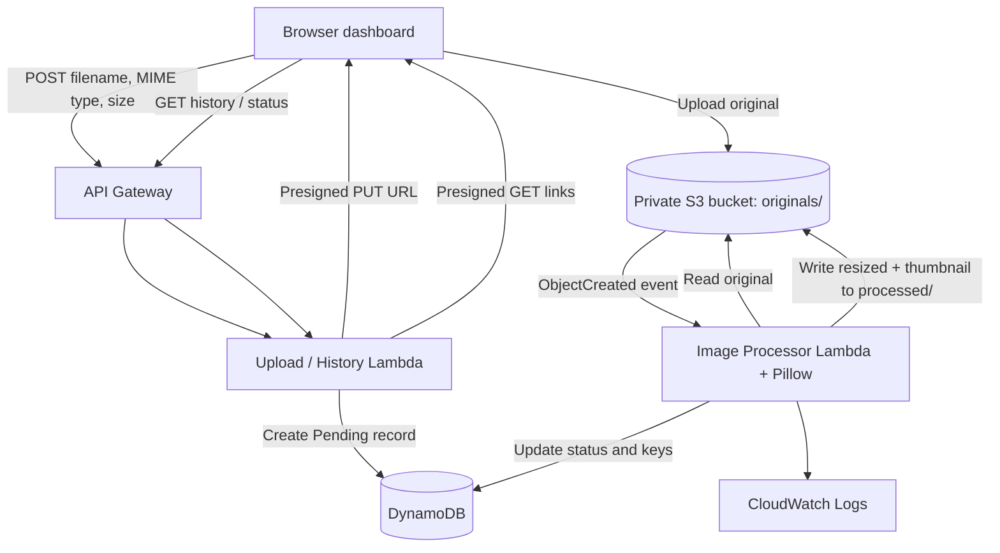

# CloudPix — A Serverless Image Processing and Storage Platform

CloudPix is a college mini-project demonstrating how a private object-storage upload can trigger asynchronous serverless image processing. A user uploads a JPG/JPEG or PNG through a short-lived S3 presigned URL. An S3 event invokes AWS Lambda, which validates the image, generates an optimized image (maximum 800 × 800) and thumbnail (maximum 200 × 200), stores both privately, and records processing state in DynamoDB.

> **Deployment status:** This repository contains deployment configuration and code. It has not been deployed to AWS by this project generator. AWS integration must be deployed and verified in your own account.

## Problem statement

Manually resizing and maintaining multiple versions of uploaded images is repetitive and can require always-on servers. CloudPix demonstrates an event-driven, pay-per-use workflow that creates image variants automatically and keeps a searchable processing history.

## Objectives

- Demonstrate serverless computing and event-driven architecture.
- Store original and processed objects privately in Amazon S3.
- Process images asynchronously with AWS Lambda and Pillow.
- Track image metadata and status using DynamoDB.
- Expose upload, history, and status endpoints through API Gateway.
- Apply basic validation, least-privilege IAM policies, and useful logging.

## Features

- Responsive dashboard with drag-and-drop and file preview.
- JPG/JPEG/PNG client-side validation and 10 MB upload limit.
- Short-lived presigned upload URL; browser never receives AWS credentials.
- S3 `originals/` object-created notification triggers the processor.
- Aspect-ratio-preserving 800 × 800 and 200 × 200 variants.
- Transparency retained for PNG files.
- Real DynamoDB history and statuses: Pending, Processing, Completed, Failed.
- Short-lived download links for private images.
- Unit tests for image processing and a GitHub Actions test workflow.

## Technology stack

HTML, CSS, vanilla JavaScript, Python 3.12, Pillow, AWS Lambda, Amazon S3, Amazon DynamoDB, Amazon API Gateway, Amazon CloudWatch, AWS SAM, GitHub Actions.

## Architecture



## Repository layout

```text
CloudPix/
├── frontend/                  # Static web app
├── backend/
│   ├── upload_handler/app.py  # Upload URL, history, status API
│   └── image_processor/app.py # S3-triggered image processing
├── tests/                     # Local unit tests
├── events/                    # Example S3 event
├── .github/workflows/tests.yml
├── template.yaml              # AWS SAM infrastructure
├── samconfig.toml
├── requirements.txt
├── SETUP.md
└── TESTING.md
```

## Quick start

Prerequisites: Python 3.12, AWS CLI configured for an account you control, AWS SAM CLI, and (for local UI) a local static web server.

1. Install Python dependencies: `python -m pip install -r requirements.txt`
2. Run local unit tests: `python -m unittest discover -s tests -v`
3. Follow [`SETUP.md`](SETUP.md) to validate and deploy the stack.
4. Copy the `ApiBaseUrl` output from the SAM stack outputs.
5. Serve `frontend/` locally, open the page, and click the **AWS serverless** badge to save the API base URL. The URL should end in `/prod`.
6. Upload an image and wait for the S3-triggered Lambda to finish.

The API base URL is saved only in that browser's local storage. No AWS credentials belong in frontend files.

## API

| Method | Path | Purpose |
|---|---|---|
| POST | `/uploads` | Request an upload URL and create a Pending record |
| GET | `/history` | Return up to 100 recent image records |
| GET | `/images/{image_id}` | Return current processing status and signed URLs |

`POST /uploads` JSON body:

```json
{"filename":"sample.jpg","content_type":"image/jpeg","size":12345}
```

The client uploads the raw bytes to the returned `upload_url` with a PUT request and the exact `Content-Type` used when requesting the URL.

## Security notes

- S3 blocks public access and encrypts objects at rest.
- The browser receives expiring presigned URLs, not AWS credentials.
- S3 keys use generated UUIDs rather than user filenames.
- IAM permissions are scoped to the app's bucket and table through SAM policy templates.
- The processor verifies image contents, accepts JPEG/PNG only, limits input size and pixel count, and does not trust the filename extension alone.
- API Gateway is not authenticated in this minimal college-project configuration. Anyone who discovers the endpoint can request upload URLs and read history. For a public/production deployment, add authentication/authorization, quotas/throttling, stricter `AllowedOrigin`, and consider per-user data isolation.
- The API currently scans the table and returns at most 100 items; suitable for a small demo, not large-scale history.
- CORS default is `*` for quick setup. Set `AllowedOrigin` to the exact origin of your hosted frontend for deployment.
- Presigned links expire after 15 minutes; upload links expire after 5 minutes.

## Cost control

Potential charges include API Gateway requests, Lambda invocations and duration, DynamoDB requests/storage, S3 storage and requests, data transfer, CloudWatch logs, and SAM deployment artifacts. Pricing and free-tier eligibility vary by region/account; this is not guaranteed to be free. Keep test images small, avoid repeated uploads, and delete the CloudFormation stack after evaluation. See `SETUP.md` for cleanup.

## Screenshots

Add screenshots of the dashboard, completed result cards, and AWS Lambda/S3/DynamoDB evidence here after you run and verify the deployed app.

## Project links

- GitHub repository: `https://github.com/YOUR-USERNAME/CloudPix`
- Deployment link: `ADD_YOUR_HOSTED_FRONTEND_URL_HERE`
- API Gateway endpoint: obtain from the `ApiBaseUrl` stack output; do not commit account-specific configuration unless intended.

## Testing

Run `python -m unittest discover -s tests -v`. The GitHub Actions workflow runs unit tests and SAM template validation. These tests do not prove that AWS resources have been deployed or that live S3 notifications work; verify the deployed flow using the steps in `TESTING.md`.
